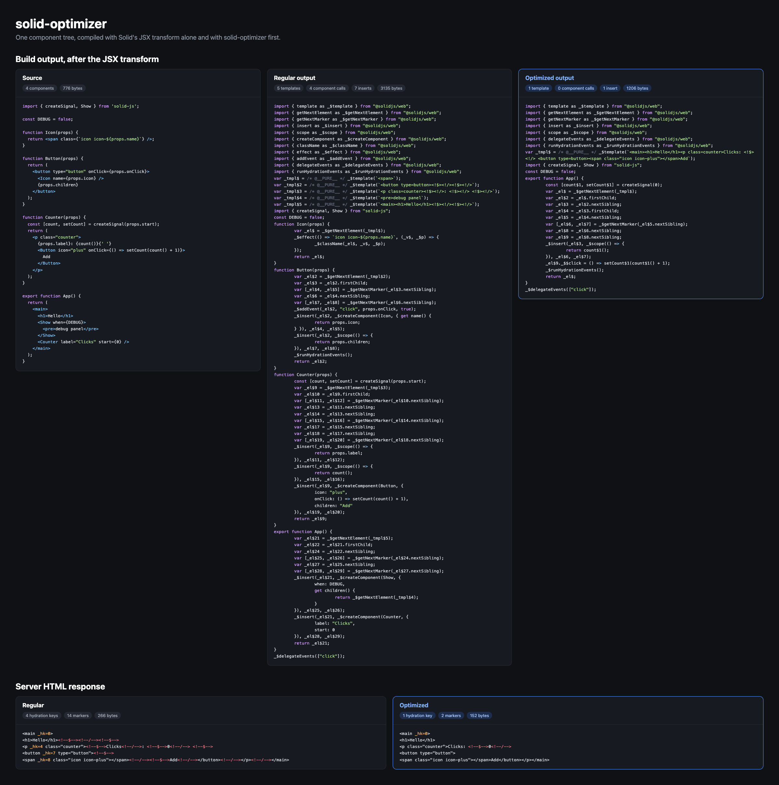

# solid-optimizer

> Experimental compile-time optimizer for SolidJS 2.0

[](https://www.npmjs.com/package/solid-optimizer)

`solid-optimizer` rewrites JSX before Solid's JSX transform lowers it. It inlines components and resolves control flow whose outcome is known at build time, so more markup lands in fewer templates.



## Install

The Solid 2.0 version is published under the `next` tag. The `latest` version is for Solid 1.x, which only gets fixes now, from the [`0.x` branch](https://github.com/lxsmnsyc/solid-optimizer/tree/0.x).

```bash
npm i -D solid-optimizer@next
```

```bash
yarn add -D solid-optimizer@next
```

```bash
pnpm add -D solid-optimizer@next
```

## Usage

```js
import { compile } from 'solid-optimizer';

const result = compile(code, { filename: 'app.jsx' });

result.code; // JSX, ready for Solid's JSX transform
result.map; // a source map, or `null` when nothing changed
```

The input and the output both keep their JSX. Run the JSX transform after `compile`.

`compile` works on a single module or on a bundled chunk that kept its JSX. A chunk holds more components in one scope, so more of them inline.

### Options

- `filename` sets the parser and the source map source. `.ts` and `.tsx` parse as TypeScript. Anything else parses as JSX. Defaults to `input.jsx`.
- `fold` turns constant folding and control-flow resolution on or off. Defaults to `true`.
- `inline` turns component inlining on or off. Defaults to `true`.
- `alwaysInline` inlines every component that can be, even where the copies are larger than the calls they replace. Defaults to `false`. See [Only where it is smaller](#only-where-it-is-smaller).
- `alwaysInlineComponents` lists top-level components to inline wherever they can be, like `alwaysInline` does for every component. The Vite plugin lists the copies from `optimizer.packages` here.
- `sharedComponents` maps top-level components that other modules use too to the number of modules that use them, this one included. Inlining one only counts its share of the declaration. `0` keeps the declaration whatever is inlined.
- `contexts` turns context provider removal on or off. Defaults to `true`.
- `memos` turns memo inlining on or off. Defaults to `true`.
- `conditionals` turns `<Show>` and `<Switch>` lowering on or off. A `<Show>` without `keyed` becomes a ternary, which Solid's JSX transform compiles to one memo instead of a component and three memos. A callback child like `{(user) => <b>{user().name}</b>}` becomes its body, with `user()` read as `when` again, when `when` reads names, members, and signal or memo getters. A `<Switch>` of such `<Match>`es becomes a chain of ternaries. Defaults to `true`.
- `builtIns` lists the names of Solid's built-in components. A tag only folds when it is one of them. An empty list turns control-flow folding off.
- `moduleSources` lists the modules Solid's built-ins are imported from. Defaults to `['solid-js', '@solidjs/web']`.
- `importedConstants` holds the constants of imported modules, keyed by the import specifier as the code writes it, then by export name. An import of one of them folds like a local `const`. See [Constants from other modules](#constants-from-other-modules).
- `globalConstants` holds values of global names and paths, such as `{ __DEV__: false, 'import.meta.env.MODE': 'production' }`. A path starts at `import.meta` or at a name the module does not declare, and folds like a constant.
- `maxPasses` limits how many rounds run. Compilation stops early once a round changes nothing. Defaults to `10`.
- `sourceMap` turns the source map on or off. Defaults to `true`.
- `report` records what the inline, provider, and memo passes leave alone, and why. The result lists them in `skipped`, each with its pass, a reason code, and a name. Defaults to `false`.

### Constants from other modules

`readModuleConstants` reads the constants a module exports, and the modules it imports from.

```js
import { compile, readModuleConstants } from 'solid-optimizer';

const config = readModuleConstants(configCode, { filename: 'config.ts' });
config.exports; // { SHOW_BANNER: true, THEME: 'light' }

compile(appCode, {
  filename: 'app.tsx',
  importedConstants: { './config': config.exports },
});
```

It keeps `export const` bindings whose value folds, a `let` the module never writes to, `export default` of a constant, and names exported from them. `import * as config` also works, as `config.NAME`. A module that re-exports constants from another module takes that module's constants in its own `importedConstants`.

> **Warning**
> The output changes the shape of the rendered tree, and with it the hydration keys. Compile a server build and its client build from the same code with the same options.

## Vite

`solid-optimizer/vite` replaces `@solidjs/vite-plugin`. It takes the same options and wraps the official plugin, so SSR, server functions, and HMR keep working.

```js
// vite.config.js
import { defineConfig } from 'vite';
import solid from 'solid-optimizer/vite';

export default defineConfig({
  plugins: [solid({ ssr: true })],
});
```

`@solidjs/vite-plugin` and `vite` are peer dependencies.

The plugin optimizes in one of two modes.

- **Chunk mode** is for client builds that do not hydrate. Constants fold and memos inline in each module first, so a branch that folds away takes its imports and `lazy()` chunks out of the bundle. Components imported from other modules are inlined there too, so the bundler drops them and the runtime code only they used. JSX is then kept through bundling. Each chunk is optimized as a whole and then lowered by Solid's JSX transform, so a component inlines anywhere in its chunk. Each chunk is also built with every component inlined that can be, and the smaller of the two, minified and gzipped, is kept. See [Only where it is smaller](#only-where-it-is-smaller).
- **Module mode** is for everything else. Each module is optimized before the official plugin lowers it, with the components it imports from other modules copied in first. A server build and its client build split chunks differently, and hydration needs both to render the same tree, so every decision depends only on the modules. Two modules that import each other do not copy each other's components.

Both modes fold constants imported from other modules in the project.

- Each import is resolved and loaded by the bundler, so aliases, virtual modules, and plugins that rewrite the module are respected.
- A module with JSX is read from this plugin's own output for it. It is skipped when it imports the importer, directly or through other modules of the project, since the two transforms would wait for each other.
- `define` entries and `import.meta.env` values fold in both modes, when every build environment gives them the same primitive value. `import.meta.env.SSR` never folds, since the server and client builds differ on it.
- Dependencies are not read, and nothing is read while serving.

The optimizer is off while serving. Set `optimizer.dev` to run module mode in dev too.

### Options

The plugin takes every option of `@solidjs/vite-plugin`, plus `optimizer`.

- `optimizer: false` uses `@solidjs/vite-plugin` as it is.
- `optimizer.fold`, `optimizer.inline`, `optimizer.alwaysInline`, `optimizer.contexts`, `optimizer.memos`, `optimizer.conditionals`, and `optimizer.maxPasses` work like the `compile` options.
- `optimizer.mode` is `'auto'` by default. Set it to `'module'` to never keep JSX through bundling.
- `optimizer.dev` also optimizes while serving. Defaults to `false`.
- `optimizer.report` reports what stays as written in each build, and why. `true` prints it. A function receives it instead, once per build environment. Defaults to `false`.
- `optimizer.packages` lists packages whose components are copied into the modules that use them, like `['@kobalte/core']`. A package has to publish its JSX, as most Solid libraries do through the `solid` export condition. Re-exports and aliases like `const Button = ButtonRoot` are followed. Their copies inline wherever they can be, whatever the estimate says, since it cannot see what the package's other modules and the runtime code only they use add up to. The bundler then drops the originals, even when the package lands in another chunk. A listed package has to be bundled in every build, or the server and client builds copy different components. Defaults to `[]`.

### Report

`optimizer.report` lists each component call, provider, and memo the optimizer left alone, grouped by reason:

```
solid-optimizer: what stays as written in client
  inline   lazy              4  About, Chart, Dashboard, Settings
  inline   copy-no-host      1  Home (./pages/Home)
  inline   no-host           1  Home
```

Each line is a pass, a reason, how many times it happened, and the names it happened to. A package's own modules are compiled too, but what they leave alone is not reported, since the app cannot change it. The app's calls of a package's components are. In chunk mode, a chunk is reported as a whole, so it also lists the package code bundled into it. The reasons for the inline pass:

- `props-use` and `view-use` mean the component uses its props in a way other than `props.name`, a spread onto an element, or a `merge()` or `omit()` view, such as passing them to a function.
- `component-params`, `component-body`, `component-return`, `component-async`, `component-recursive`, and `component-this` mean the component's own shape is not supported.
- `component-write` means the component's statements assign to something declared outside it, like a counter at the top of the module. A copy's statements run before the JSX around the call, so that JSX would see the write too early.
- `call-spread` and `call-namespace` mean the call site passes a spread or a namespaced attribute. `call-ref` means its `ref` is an expression other than a name, a function, or an array of them, and `ref-use` means the component uses `props.ref` other than as a `ref`.
- `no-host` means the component has statements, and the call is not in JSX that a component or one of Solid's callbacks returns. A `<Show>` child or a `fallback` is one such place.
- `size` means the copies would be larger than the calls.
- `lazy`, `imported`, `nested`, and `not-a-function` mean the tag is not a component declared at the top of the same module or chunk.
- A reason that starts with `copy-` is about copying a component from another module. `copy-package` means it comes from a package in `node_modules` that `optimizer.packages` does not list, `copy-cycle` means the two modules import each other, `copy-wrapper` means the component only returns a call of another component in its module, and `copy-size` means the copy was larger.

The provider pass reports `open-component`, `open-call`, `open-new`, `open-spread`, and `open-outer` for code under the provider that it cannot see into, and `provider-value`, `provider-undefined`, and `provider-shape` for a value or provider it cannot handle. The memo pass reports `memo-reads`, `memo-read-place`, `memo-constant`, and a few more for a memo it keeps.

### Limits

- Chunk mode is skipped when the `babel` option is set or `compiler` is `'babel'`, since those passes need each module.
- An export named `__so_local$name` is added to a module for each local binding its exported components need, so a copy in another module can import it. In chunk mode, entry modules get none.
- A component used in several chunks is copied into each of them, where each copy is no larger than its call.
- Components from dependencies in `node_modules` are only copied from the packages `optimizer.packages` lists.
- `.tsrx` modules are lowered by the official plugin and are not optimized.

## Features

### Component inlining

A component call is replaced with the component's JSX.

```jsx
function Title(props) {
  return <h1 class="title">{props.label}</h1>;
}

export function App() {
  return (
    <main>
      <Title label="Hello" />
    </main>
  );
}
```

becomes

```jsx
export function App() {
  return (
    <main>
      <h1 class="title">{'Hello'}</h1>
    </main>
  );
}
```

Solid then creates one template for `<main>` instead of two.

- A read of `props.name` becomes the attribute's expression. Solid passes dynamic props as getters, so the expression runs at every read, as before.
- A static prop that must be evaluated once, like a function read twice, is stored in a `const` first.
- `{props.children}`, and a prop whose value is JSX, splice their JSX in place so it joins the template.
- Statements in the component body move into the function whose returned JSX holds the call. The call must sit directly in that JSX, with only intrinsic elements and fragments around it. The function must run untracked, once each time it creates that JSX:
  - a component;
  - the child callback of `<For>` or `<Repeat>`;
  - the child callback of `<Show>` or `<Match>`, when it takes the value;
  - the callback given to `render`.
- Bindings declared in the component get fresh names in every copy.
- A component nothing else uses is removed, with any alias of it that nothing uses.

A component inlines when all of these hold:

- It is declared once at the top level, with a capitalized name. A call through an alias, like `const Separator = SeparatorRoot`, is a call of the component it names.
- Its parameter is one identifier that is only read as `props.name`, spread onto an element as `{...props}`, or passed to `merge()` and `omit()`. See below.
- Its body ends in the only `return`, and that `return` returns JSX.
- It does not use `this`, `arguments`, `super`, or `new.target`.
- The call site has no spread attribute and no namespaced attribute.
- A `ref` at the call site moves to the element the component gives `props.ref` to, when its value is a name, a function, or an array of them, and the component only uses `props.ref` as the `ref` of an element, of another component, or in a spread. Both run while the element is made, untracked, so the element gets the same ref. In an array, `void 0` and `untrack(() => ...)` around a name or a function count too: Solid skips an empty entry, and runs the whole `ref` untracked.

The props can go through `merge()` and `omit()` first, declared as a `const` in the component:

```jsx
function Button(props) {
  const merged = merge({ type: 'button' }, props);
  const rest = omit(merged, 'label');
  return (
    <button type={merged.type} {...rest}>
      {props.label}
    </button>
  );
}
```

- A default has to be a literal, like `'button'`, `0`, or `false`.
- `omit()` has to name its keys as string literals.
- A view can only be read as `view.name`, spread onto an element, or passed to another `merge()` or `omit()`.
- A spread becomes the attributes the call site passes, and it cannot repeat an attribute the element already has. Its `children` become the element's children, so the element must have none of its own.

Inlining accepts two differences:

- A prop called as `props.name()` runs with its own receiver as `this`, not the props object.
- Moved statements run before the host's JSX is created. The order of effect registration between siblings can change.

Inlined JSX is a copy, so its source map points at the call site it replaced.

#### Only where it is smaller

Every copy repeats the component's own code, so inlining a component at many calls can make the output larger than the calls were. Before inlining, each component's copies are compared with what they replace, as Solid's JSX transform would lower them:

- A copy saves the component call, and the getters of its props. Elements it puts directly in another element join that element's template.
- A copy costs the component's statements, its dynamic attributes and children, and the elements that cannot join a template. Constant props are folded first, so a branch they rule out costs nothing.
- When every call inlines and nothing else uses the component, its declaration goes away too.
- A call in its children that can only inline once it does, because that component has statements to hoist, counts too.
- A call in its body that can only inline in a copy counts too, such as a call that spreads a `merge()` or `omit()` view, which each call site resolves. The copy is measured with that call inlined, and the called component's declaration goes away when nothing else uses it.

A component inlines only when its copies are no larger. A small component, or one used once, inlines at every call. A wrapper used many times, whose root is another component, like most wrappers of a component library, stays a component.

The estimate weighs each component on its own, so it cannot see runtime code that only goes once every call that needs it is inlined, like `<Dynamic>`, `merge()`, and `omit()` behind a headless library's components. In chunk mode, the Vite plugin also builds each chunk with every component inlined that can be, as `alwaysInline` does, minifies and gzips both, and keeps the smaller one. The runtime only shrinks when it is in the same chunk as the calls.

In the Vite plugin, a component copied from another module counts the module's share of its declaration: all of it when the importer is its only user, and one part in n when n modules use it, since it goes away once every one of them copies it. The plugin reads which modules use each export from the files the entries reach, and from the module scripts of an HTML entry. A re-export, a dynamic import, a use as a value, or a user the component's module imports back keeps the declaration whole.

Set `alwaysInline` to inline every component that can be.

### Context inlining

A context provider whose readers are all visible is removed, and each read gets the provider's value.

```jsx
const Theme = createContext();

function Label() {
  const theme = useContext(Theme);
  return <span class={theme}>label</span>;
}

export function App() {
  return (
    <main>
      <Theme value="dark">
        <Label />
      </Theme>
    </main>
  );
}
```

becomes

```jsx
export function App() {
  const theme$1 = 'dark';
  return (
    <main>
      <span class={'dark'}>label</span>
    </main>
  );
}
```

- Everything under the provider has to be visible: intrinsic elements, Solid's built-ins, and components that inline. A call to an unknown function, or a read of a component's `props`, keeps the provider.
- An object value is stored in a `const` once, so every reader gets the same object.
- The value must never be `undefined`.
- Removing the provider removes its owner, so the hydration keys change. Compile a server build and its client build with the same options.

See [strategy.md](https://github.com/lxsmnsyc/solid-optimizer/blob/main/strategy.md) for the exact rules.

### Memo inlining

A `createMemo` whose result is new on every run, such as an object, array, or JSX, never stops an update. When it is also read once, as the whole of a tracked JSX expression, the read runs the computation itself.

```jsx
const style = createMemo(() => ({ color: color() }));
return <p style={style()} />;
```

becomes `<p style={{ color: color() }} />`. See [strategy.md](https://github.com/lxsmnsyc/solid-optimizer/blob/main/strategy.md) for the exact rules.

A memo whose computation folds to a literal never changes. Every call of it becomes the literal, however many there are, when each call comes after the declaration and nothing else uses the memo.

```jsx
const size = createMemo(() => 1 + 2);
return <p>{size() * 2}</p>;
```

becomes `<p>{6}</p>`.

Solid's `children` helper over JSX, read once as an element's child, becomes that JSX. The helper resolves JSX the same way inserting it does, and nothing makes it run again.

```jsx
const c = children(() => <b>x</b>);
return <div>{c()}</div>;
```

becomes `<div><b>x</b></div>`. This is what a component that calls `children(() => props.children)` leaves once it is inlined with JSX children.

### Constant folding and control flow

This follows the `optimize` option of `@solidjs/compiler` ([solidjs/solid#3231](https://github.com/solidjs/solid/pull/3231)).

- Constant expressions fold, including `const` bindings and `let` bindings nothing writes to, at any scope.
- Branches that a constant condition never takes are removed. So are statements after a `return`, `throw`, `break`, or `continue`.
- `<Show when>` becomes its children or its `fallback`.
- `<For each>` becomes its `fallback` when `each` is an empty array literal or a falsy constant.
- `<For>` over a constant list becomes one copy of its row per item, when the copies are estimated to be no larger than the loop. The list is an array literal, or a `const` of one that only `<For>` reads and that is not exported. Each item is a primitive literal, or an object literal of them. The row has to be an arrow function whose body is JSX without a `ref` or a spread, and read the item as `item.key`, or as itself when it is a primitive.

  ```jsx
  const LINKS = [
    { href: '/', label: 'Home' },
    { href: '/docs', label: 'Docs' },
  ];
  <nav>
    <For each={LINKS}>{(link) => <a href={link.href}>{link.label}</a>}</For>
  </nav>;
  ```

  becomes `<nav><a href={'/'}>{'Home'}</a><a href={'/docs'}>{'Docs'}</a></nav>`, which lowers to one template. Each row had its own owner, so this shifts the hydration keys after it.

- `<Repeat count>` becomes its `fallback` when `count` is below one.
- `<Switch>` drops each `<Match>` that is always false, and becomes the first `<Match>` that is always true.
- `<Dynamic component="div">` becomes `<div>`. `<Dynamic component={Card}>` becomes `<Card>` when `Card` is a capitalized component declared at the top level, as a function or with `lazy`, that nothing reassigns. An imported component stays, since an import could hold a tag name.
- `untrack(() => value)` becomes the value when the value is a constant. A component inlined with a literal prop can leave one, like `untrack(() => props.as)`.
- A call of an arrow function whose body is JSX, such as a render prop left by inlining, becomes the JSX when it is an element's child and each argument is a constant or a binding nothing reassigns. `{((n) => <li>{n}</li>)(1)}` becomes `<li>{1}</li>`. A `ref` or a spread in the JSX keeps the call, since both run while the JSX is made.

A built-in only folds when the tag resolves to Solid's component. The tag must bind to nothing, or be imported from one of `moduleSources`. A tag with a spread attribute or a function child never folds. `<Portal>`, `<Loading>`, `<Errored>`, and `<Reveal>` never fold.

A call to Solid's `lazy` is marked `/* @__PURE__ */`, so the bundler drops one that a folded branch left unused, along with its chunk.

A condition that is discarded but has side effects still runs. `[effect()] && value` becomes `([effect()], value)`.

## Sponsors


## License

MIT © [lxsmnsyc](https://github.com/lxsmnsyc)
